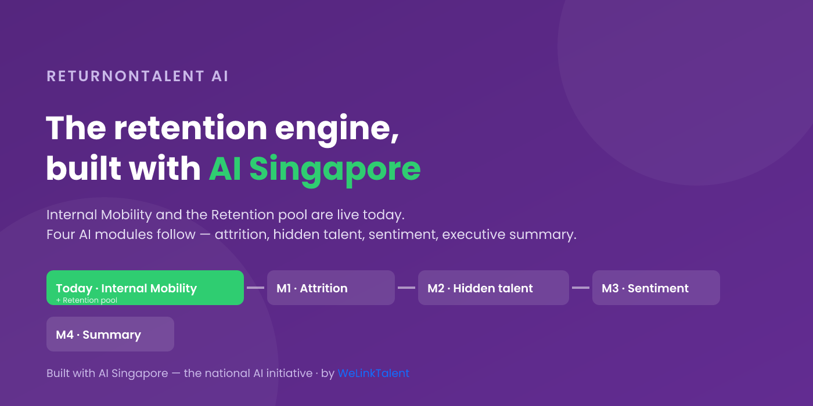
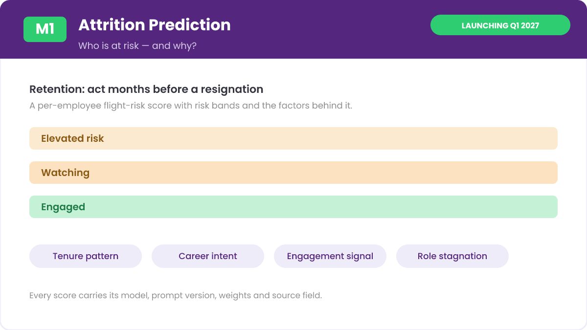
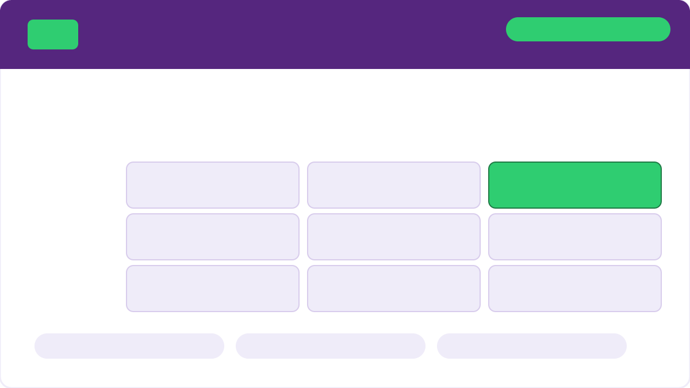
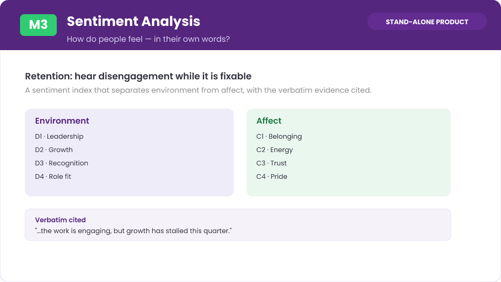
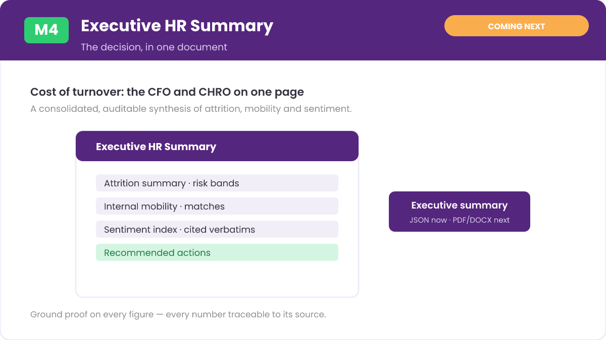
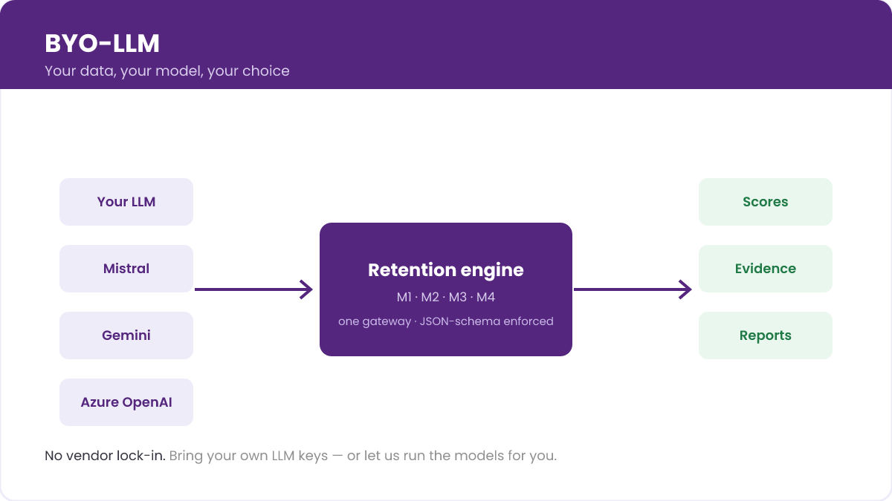

# ReturnOnTalent AI

**The talent you cannot afford to lose is already thinking of leaving — and the talent you need is already on your payroll.**

Most companies only find out too late: at the resignation, at the replacement invoice, or at the quarter a critical role stayed open. ReturnOnTalent exists to change that. We are building an AI layer that turns retention, mobility and sentiment from after-the-fact reports into decisions you can act on months earlier — and every number carries its proof.

## What this repository is

This repository explains what ReturnOnTalent AI is, what is live today and the roadmap for the four AI modules — in enough technical detail for a product or engineering reader, without disclosing proprietary algorithms, prompts or scoring logic.

- Market-facing overview: [returnontalent.io/ai-features](https://www.returnontalent.io/ai-features)
- The four modules in detail: [docs/modules.md](docs/modules.md)
- How it works, without the IP: [docs/how-it-works.md](docs/how-it-works.md)
- Release roadmap: [docs/roadmap.md](docs/roadmap.md)
- Frequently asked questions: [docs/faq.md](docs/faq.md)

## Four modules, four business problems solved

One engine, one data foundation. Each module answers a single question a CxO actually asks.

### 1 — Attrition Prediction: see the risk before the resignation

**The problem.** Your best people don't give you months of warning — you see it in the resignation letter, and then you pay to replace them.

**What we build.** A score per employee, with risk bands and the reasons behind the score. See who is at risk while there is still time to act — before the replacement cost is ever incurred.

### 2 — Hidden Talent: hire from inside first

**The problem.** You recruit externally for a skill that already sits inside your company — because you cannot see it.

**What we build.** A clear view of performance and potential across your people, mapped to what they actually want in their career. The cheapest hire is the one you already made.

### 3 — Sentiment: hear disengagement while it is still fixable

**The problem.** Disengagement is silent — until it becomes a resignation. Surveys arrive too late and tell you too little.

**What we build.** A sentiment index that separates what people feel from what the environment causes, with the evidence behind every score. Listen without surveilling.

### 4 — Executive Summary: the CHRO and the CFO read the same page

**The problem.** HR and finance argue over different numbers — attrition, mobility and sentiment each sit in their own report.

**What we build.** One auditable summary that unites the three into a single, board-ready view — every figure traceable to its source.

## Why this is different: no score without proof

Two rules, built in from the start.

- **No score without proof.** Every score cites its source — the field and the evidence behind it. You can challenge a number and get an answer. That is the difference between a retention dashboard and a retention decision.
- **No score without a version.** Every output carries the model, the prompt version, the weights and the date behind it. Results stay auditable, run after run.

## Your model, your choice

Run on the language model provider you already trust — bring your own keys and keep your people data where your compliance requires it. Or let us manage the models for you. The engine is the same either way.

## Live today, launching next

- **Live today** — the Internal Mobility process and the Retention pool.
- **Launching Q1 2027** — Attrition Prediction and Hidden Talent Identification.
- **Then** — Sentiment Analysis (stand-alone) and the Executive Report, with enterprise controls: single sign-on, multi-tenant and usage-based billing.

Full roadmap: [docs/roadmap.md](docs/roadmap.md).

## Built with AI Singapore

The core engine was co-developed with AI Singapore's AI Apprenticeship Programme (AIAP), Industry track, Batch 22, under the French Chamber of Commerce in Singapore AI Lab framework. The intellectual property belongs to WeLinkTalent Pte Ltd.

## Next step

We are opening a small number of pilot partnerships for companies that want retention decided on evidence. Tell us who you are, and we will walk you through what is live and what is next.

[Request early access](https://www.returnontalent.io/contact-us)

---

© WeLinkTalent Pte Ltd. All rights reserved.
