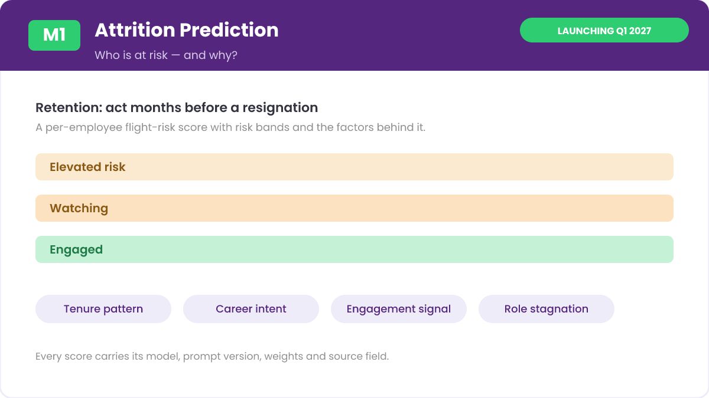
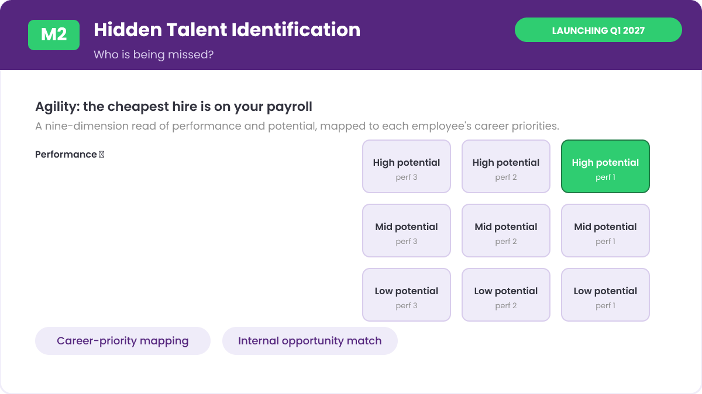
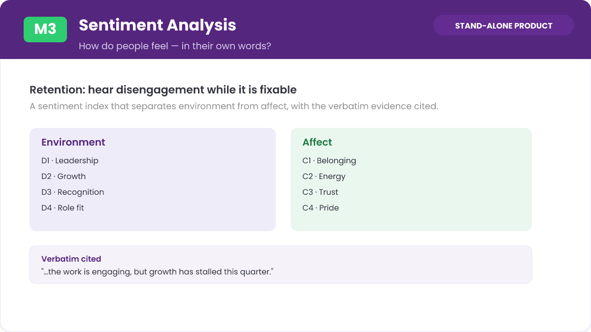
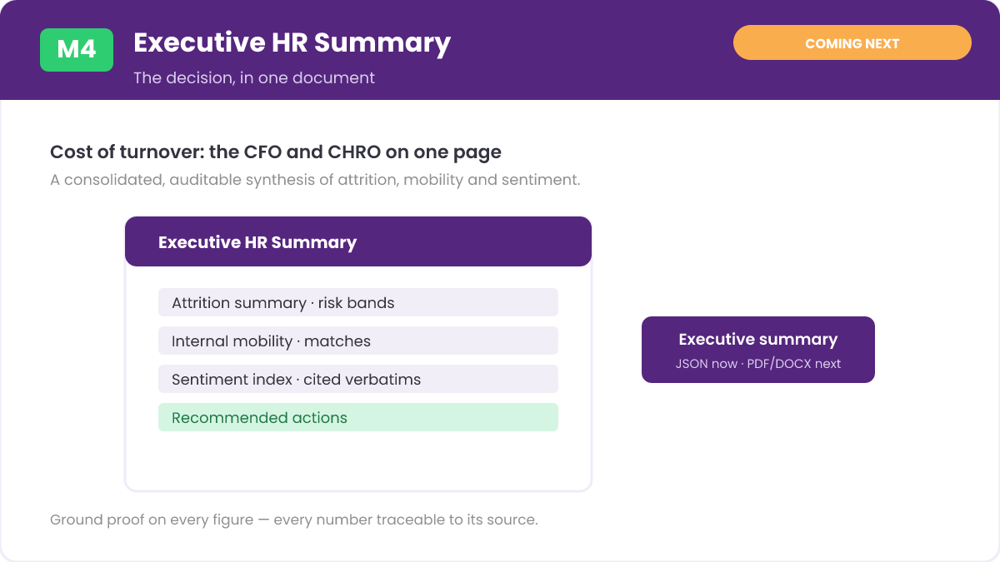
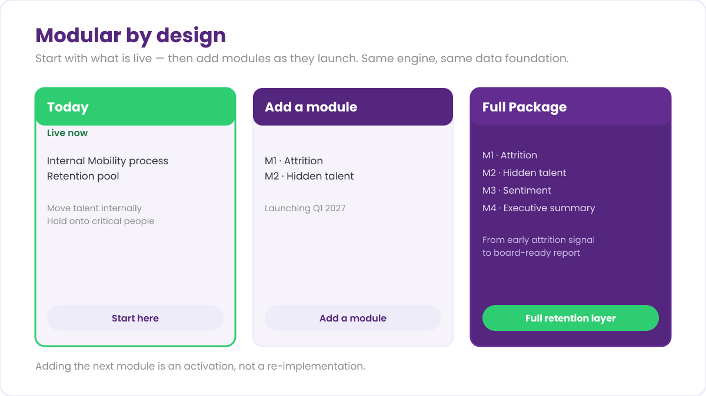

# The four modules

ReturnOnTalent AI is four modules, one engine, one data foundation. Each module answers a single question a CxO actually asks, and each is built on the same rule: no score without proof.

## 1 — Attrition Prediction: see the risk before the resignation

**The question.** Who is likely to leave, and why?

**The problem.** Your best people don't give you months of warning — you see it in the resignation letter, and then you pay to replace them.

**What we build.** A score per employee, with risk bands and the reasons behind the score. See who is at risk while there is still time to act — before the replacement cost is ever incurred.

**Status.** Launching Q1 2027.

## 2 — Hidden Talent: hire from inside first

**The question.** Which skill do we already have, that we are about to hire for?

**The problem.** You recruit externally for a skill that already sits inside your company — because you cannot see it.

**What we build.** A clear view of performance and potential across your people, mapped to what they actually want in their career. The cheapest hire is the one you already made.

**Status.** Launching Q1 2027. The underlying Internal Mobility process and the Retention pool are live today.

## 3 — Sentiment: hear disengagement while it is still fixable

**The question.** What are people actually feeling, and why?

**The problem.** Disengagement is silent — until it becomes a resignation. Surveys arrive too late and tell you too little.

**What we build.** A sentiment index that separates what people feel from what the environment causes, with the evidence behind every score. Listen without surveilling.

**Status.** Stand-alone release following Q1 2027.

## 4 — Executive Summary: the CHRO and the CFO read the same page

**The question.** What is the single, board-ready picture across attrition, mobility and sentiment?

**The problem.** HR and finance argue over different numbers — attrition, mobility and sentiment each sit in their own report.

**What we build.** One auditable summary that unites the three into a single, board-ready view — every figure traceable to its source.

**Status.** Following Q1 2027, with enterprise controls: single sign-on, multi-tenant and usage-based billing.

## One engine, four modules

The modules share a single data foundation and a single run pipeline. A customer can start with one module and add the others as the need arises — the same import, the same audit trail, the same standards across all four.

[Back to the overview](../)
